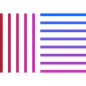
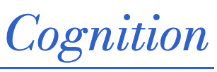
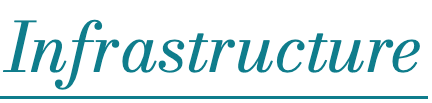
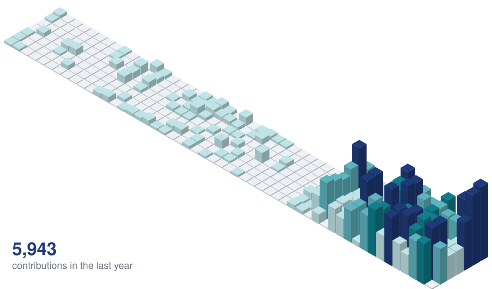

<picture>
  <source media="(prefers-color-scheme: dark)" srcset="assets/header-dark.svg">
  
</picture>

[Website](https://howiehwong.github.io/) &nbsp;·&nbsp; [Scholar](https://scholar.google.com/citations?user=HvzvvqQAAAAJ) &nbsp;·&nbsp; [X](https://x.com/HowieH36226) &nbsp;·&nbsp; [LinkedIn](https://www.linkedin.com/in/yue-huang-696816265/) &nbsp;·&nbsp; [Email](mailto:yhuang37@nd.edu) &nbsp;·&nbsp; [CV](https://howiehwong.github.io/cv.html)

Past · Present

<picture><source media="(prefers-color-scheme: dark)" srcset="assets/logos/Notre_Dame-96-dark.webp"></picture> &nbsp;&nbsp; <picture><source media="(prefers-color-scheme: dark)" srcset="assets/logos/Microsoft-Logo-96-dark.webp"></picture> &nbsp;&nbsp; <picture><source media="(prefers-color-scheme: dark)" srcset="assets/logos/mit_ibm-96-dark.webp"></picture> &nbsp;&nbsp; <picture><source media="(prefers-color-scheme: dark)" srcset="assets/logos/cornell-96-dark.webp"></picture> &nbsp;&nbsp; <picture><source media="(prefers-color-scheme: dark)" srcset="assets/logos/thu-96-dark.webp"></picture> &nbsp;&nbsp; <picture><source media="(prefers-color-scheme: dark)" srcset="assets/logos/scu-96-dark.webp"></picture>

Hi there 

I am a third-year PhD student at the [University of Notre Dame](https://www.nd.edu/), advised by Prof. [Xiangliang Zhang](https://scholar.google.com/citations?user=BhRJe4wAAAAJ&hl=en) in the [MINE Lab](https://mine-lab-nd.github.io/).

Previously at [Microsoft Research](https://www.microsoft.com/en-us/research/), [MIT-IBM Watson AI Lab](https://mitibmwatsonailab.mit.edu/), [IBM Research](https://research.ibm.com/), and [Tsinghua KEG](https://keg.cs.tsinghua.edu.cn/).

## Research

<strong>I build self-improvement <em>humane</em> and <em>humanized</em> intelligence</strong>: foundation models and agentic systems <em>aligned with human values</em>, informed by human <em>cognition</em>, and supported by reliable <em>infrastructure</em>.

<picture>
  <source media="(prefers-color-scheme: dark)" srcset="assets/lane-alignment-dark.png">
  
</picture>

I study how to align foundation models and agentic systems with human values, from individual behavior to collective dynamics. My work uncovers emergent social intelligence risks that agent-level safeguards alone cannot prevent ([Emergent Social Intelligence Risks](https://arxiv.org/abs/2603.27771) Nature Machine Intelligence). I also benchmark trustworthiness ([TrustLLM](https://proceedings.mlr.press/v235/huang24x.html) ICML'24, [TrustGen](https://openreview.net/forum?id=Fcf5fLmaeG) ICLR'26), train honest and helpful models ([HonestLLM](https://arxiv.org/abs/2406.00380) NeurIPS'24), examine biases in LLM-as-a-judge ([Justice or Prejudice?](https://openreview.net/forum?id=3GTtZFiajM) ICLR'25), and prioritize safety in alignment ([SPA](https://arxiv.org/abs/2511.06222) AAAI'26 Oral, [Capability-Oriented Risk](https://arxiv.org/abs/2602.12124) ICML'26).

<picture>
  <source media="(prefers-color-scheme: dark)" srcset="assets/lane-cognition-dark.png">
  
</picture>

I probe how models reason and perceive, deciding when to use tools ([MetaTool](https://arxiv.org/abs/2310.03128) ICLR'24), adapting reasoning style to the task ([AdaReasoner](https://mine-lab-nd.github.io/project/adareasoner.html) NeurIPS'25 Spotlight), exposing flaws in social character simulation ([TrustSim](https://openreview.net/forum?id=B5E3ijlLML) COLM'25), diagnosing failure modes at scale ([ProbeLLM](https://arxiv.org/abs/2602.12966) ICML'26), ranking models by question difficulty ([RankLLM](https://arxiv.org/abs/2602.12424) ICLR'26), and probing visual aesthetic judgment ([VAB](https://vab.bakelab.ai/) COLM'26). I also explore emotionally-adaptive generative AI ([EmoNest](https://openreview.net/forum?id=cyGU1R569i) NeurIPS'25 Creative, [NARRA-Gym](https://arxiv.org/abs/2605.08503) NeurIPS'26, [Omelune](https://howiehwong.github.io/omelune/) Mac app).

<picture>
  <source media="(prefers-color-scheme: dark)" srcset="assets/lane-infrastructure-dark.png">
  
</picture>

I build the toolchain that makes the above possible: frameworks for unified synthetic data ([DataGen](https://openreview.net/forum?id=F5R0lG74Tu) ICLR'25, [ChemOrch](https://github.com/HowieHwong/ChemOrch) NeurIPS'25), synthetic interaction data for scalable personalization ([PersonaGym](https://arxiv.org/abs/2602.12394) KDD'26), foundational guardrails for safer agentic systems ([Safiron](https://openreview.net/forum?id=M47SWYubR5) ICLR'26), a new guardian model paradigm ([Guardian-as-an-Advisor](https://arxiv.org/abs/2604.07655) ACL'26 Findings), agent infrastructure that turns compute into verifiable improvement and has broken 120 world records in mathematics ([Épi](https://bakeai.inc/research/articles/epi/) Bake AI), and infrastructure for recursive self-improvement ([RSI Arena](https://rsiarena.org/) Live at COLM'26).

## Recent contributions

<!-- recent-contributions:start -->

<!-- recent-contributions:end -->

