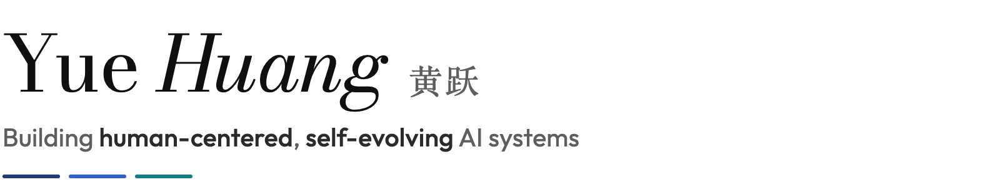

<picture>
  <source media="(prefers-color-scheme: dark)" srcset="assets/header-dark.png">
  
</picture>

[Website](https://howiehwong.github.io/) &nbsp;·&nbsp; [Google Scholar](https://scholar.google.com/citations?user=HvzvvqQAAAAJ) &nbsp;·&nbsp; [X](https://x.com/HowieH36226) &nbsp;·&nbsp; [LinkedIn](https://www.linkedin.com/in/yue-huang-696816265/) &nbsp;·&nbsp; [Email](mailto:yhuang37@nd.edu)

I'm a third-year Ph.D. student at the [University of Notre Dame](https://www.nd.edu/), advised by Prof. [Xiangliang Zhang](https://scholar.google.com/citations?user=BhRJe4wAAAAJ) in the [MINE Lab](https://mine-lab-nd.github.io/), and a visiting researcher at [Stanford University](https://www.stanford.edu/). Before that, I did research at Microsoft Research, the MIT-IBM Watson AI Lab & IBM Research, and Tsinghua KEG.

#### Highlights

- 📄 Our study of [emergent risks in multi-agent systems](https://arxiv.org/abs/2603.27771) is accepted in principle at *Nature Machine Intelligence*.
- 🧮 [Épi](https://bakeai.inc/research/articles/epi/), my agent system, broke 120 world records in mathematics at the time.
- 🏟️ [RSI Arena](https://rsiarena.org/), a live arena for recursive self-improvement, drew more than 10,000 viewers.
- 🛡️ [TrustLLM](https://github.com/HowieHwong/TrustLLM) is recognized by the International AI Safety Report, NIST and the U.S. Department of Defense.
